# RangeDay

**A member app for a private sporting club: book a field or a lesson, see how busy each area is, RSVP to events, reserve pro shop gear, and give the front desk one screen for the whole day.**

Built from my product case study ([RangeDay_Product_Case_Study.pdf](RangeDay_Product_Case_Study.pdf)) and its [wireframes](wireframes.html). Mobile-first, with a staff console for tablet or desktop. **Status: working beta**, with real accounts and a real database. A club's staff can run it from one admin area.

**Live demo:** [rangeday.vercel.app](https://rangeday.vercel.app). Create an account, or tap **Try the demo** as Sam (member) or Jordan (staff).

> **Data notice.** Oak & Feather Ranch is a fictional club (the case study calls it Cedar Ridge Sporting Club). Every member, booking, instructor, event, item and number in the demo is synthetic. The public demo resets weekly.

<p>
  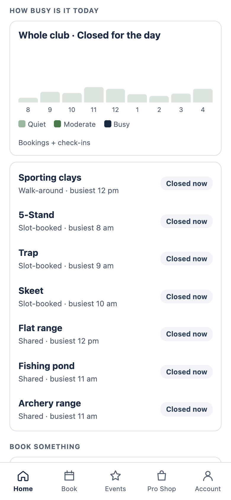
  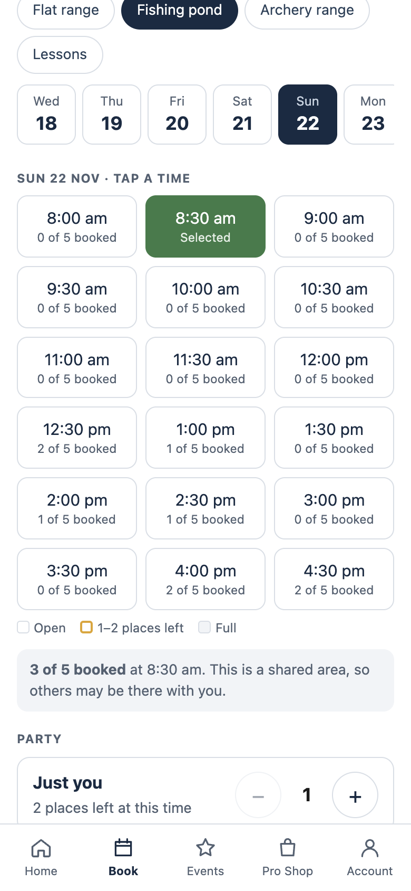
  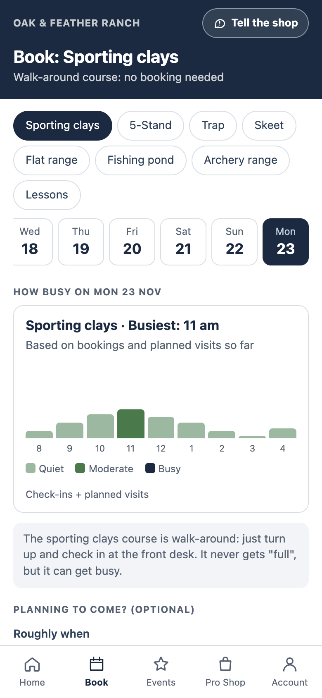
  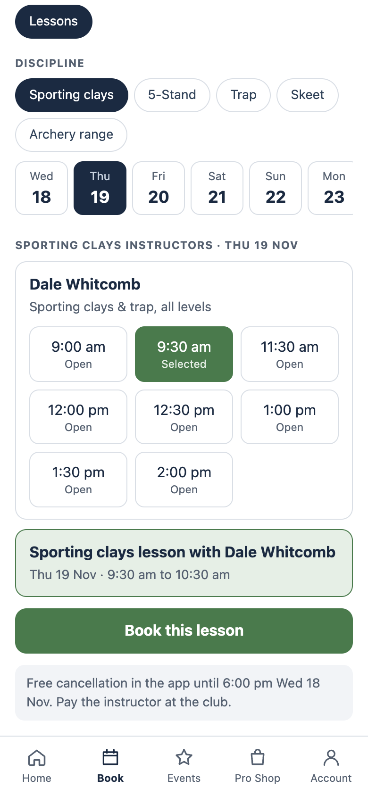
</p>


---

## The problem

At the club (850 members, about 600 active), **everything runs through the front desk phone and a paper binder.**

- Members can only book during desk hours, and can't see what's open. *"I plan my weekend at 11 pm. Calling isn't an option then."*
- **51% of 640 desk calls** in two weeks were about bookings, and another **18% were "do you have X in stock?"**
- The binder causes **double-bookings (about 6 a month)**, and nobody can measure **no-shows (about 9%)**.
- Staff spend roughly **20 hours a week** on routine calls.

*(All figures are synthetic, from the case study's discovery work: 14 member interviews, 6 staff interviews, a 212-person survey and a call log.)*

## Who it's for

| Persona | Job to be done | What they get |
|---|---|---|
| **Sam, weekend member** | Lock in a Saturday slot or a lesson without calling | Book any time in a few taps; see how busy each area is; reserve shells before driving out |
| **Jordan, front desk lead** | Keep the day running | App and phone bookings in one list, one-tap check-in, clays walk-in check-ins, lesson schedule, pickup queue, member request queue |
| **Club manager** | Set the club up and measure it | Settings for hours, areas, policies, shop and branding; staff accounts; utilization and no-show tracking |

## What's in the beta

| Area | What it does |
|---|---|
| **Three booking types** | Each area is set to one of three types. **Slot-booked** (5-Stand, Trap, Skeet): your own field per 30-minute slot, which can be fully booked. **Shared** (Flat range, Fishing pond, Archery range): book a time but share the area, up to 5 people per slot (configurable), showing *"2 of 5 booked"*. **Walk-around** (the 15-station clays course): no booking and never "full". It shows *Quiet / Moderate / Busy* from desk check-ins and optional "Planning to come?" visits. |
| **Lessons** | Pick a discipline and a date, see which instructors are free (name, specialty, open times), and book. Staff add instructors, set weekly availability, block days off and see the schedule. An instructor can never be double-booked. |
| **Busy meter, per area** | Hour by hour for every area and any day, measured the way that area is used: fields booked, people out of the limit, or people on the course. |
| **Events** | Repeating events (*Sunset Clays* weekly, *Members Shoot* first Saturday monthly, the yearly *Rodeo*) plus one-offs like the *Color Shoot*. RSVP with a **waitlist** when full: when someone cancels or staff add places, the next person moves up automatically. Staff see the Going and Waitlist lists. |
| **Reserve for pickup** | Reserve an item; staff confirm or decline with a note. Requests expire after X days if unanswered, and holds X days after confirmation (default 3). No stock count, no payment. |
| **Let the shop know** | From the **Tell the shop** button at the top of every screen, members send non-urgent requests or problem reports to the pro shop (*"Trap launcher is out of clays"*): pick an area and a type, and write a short note. An "Urgent or safety issue? Call the shop" line comes first. Staff work a queue filtered by status and area, and mark requests In progress or Done. Who handled each one, and when, is saved. It's one-way, with no chat, and every request is kept as a permanent log for spotting patterns. |
| **Accounts** | Email and password sign-up, log in and out, change password, delete account. Staff role, with every staff page *and* action checked on the server. |
| **Club settings** | One admin page for club name, logo, colours, opening hours, areas and booking types, fields, pro shop items and policies. Nothing is hard-coded. |
| **Staff desk** | Today's bookings (app and phone), check-in and no-shows, clays check-ins, phone bookings under the same rules, the lesson schedule, events, the pickup queue and a People page. |

<p>
  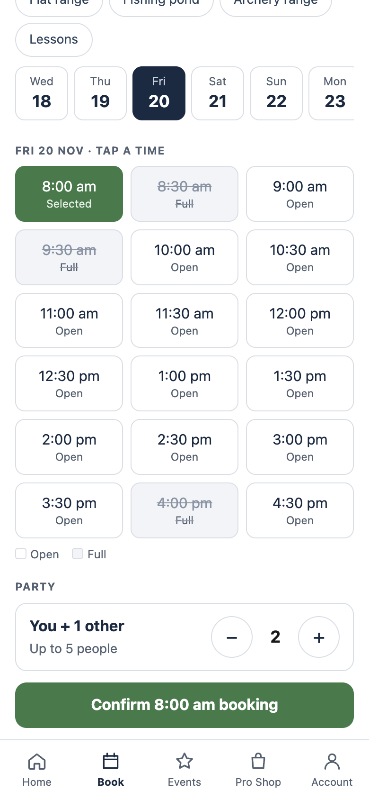
  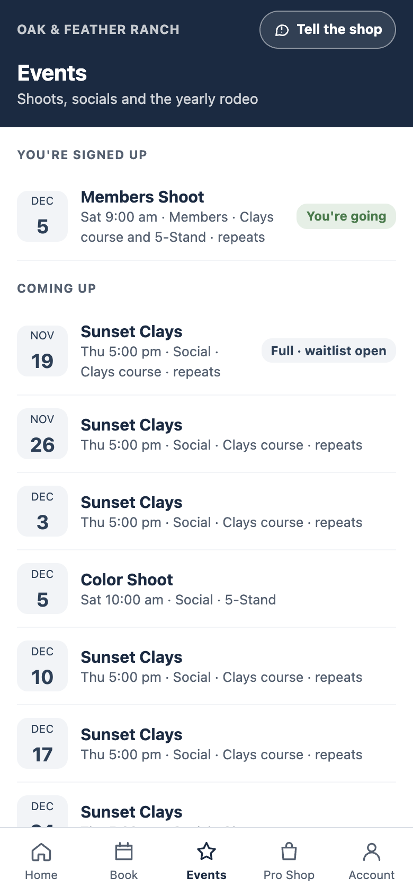
  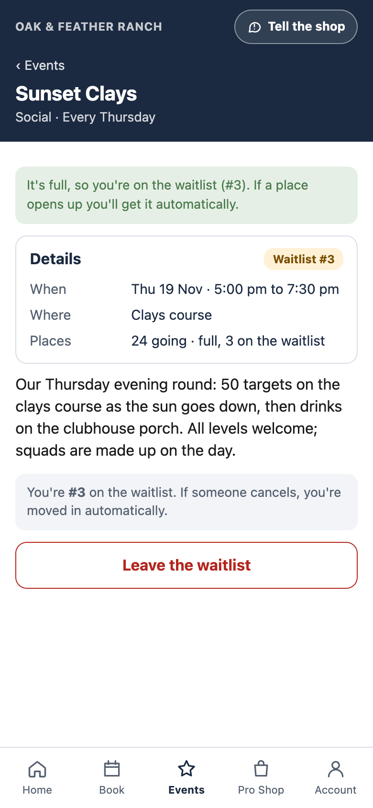
  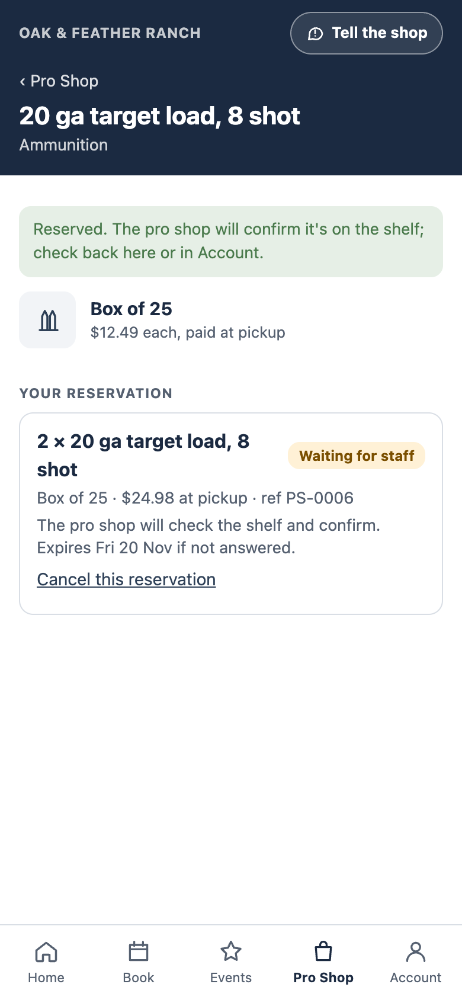
</p>
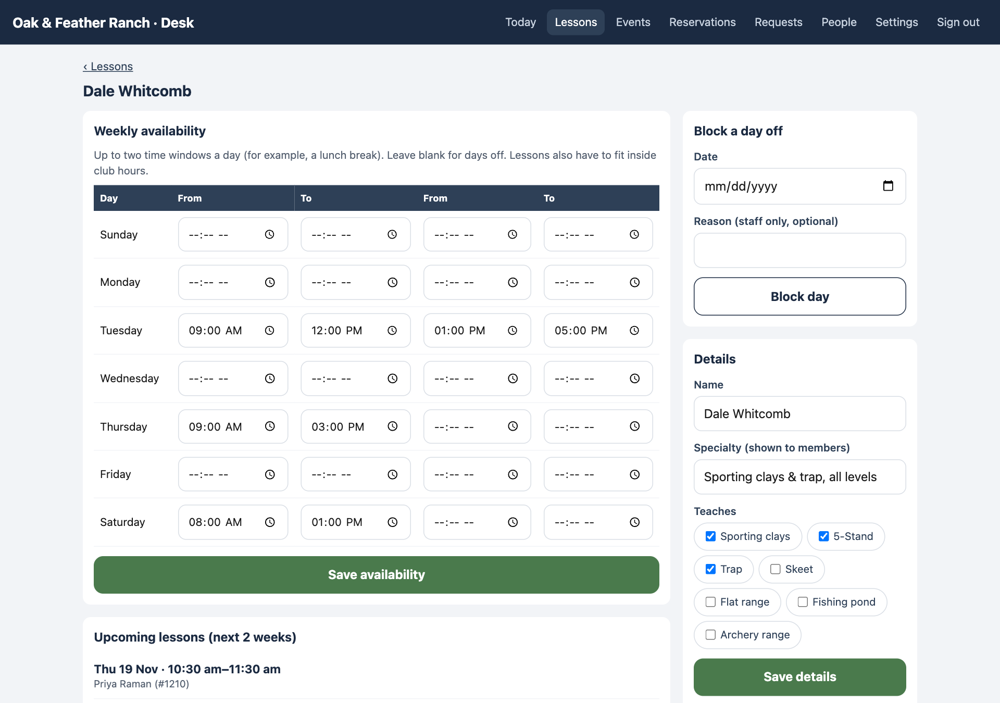
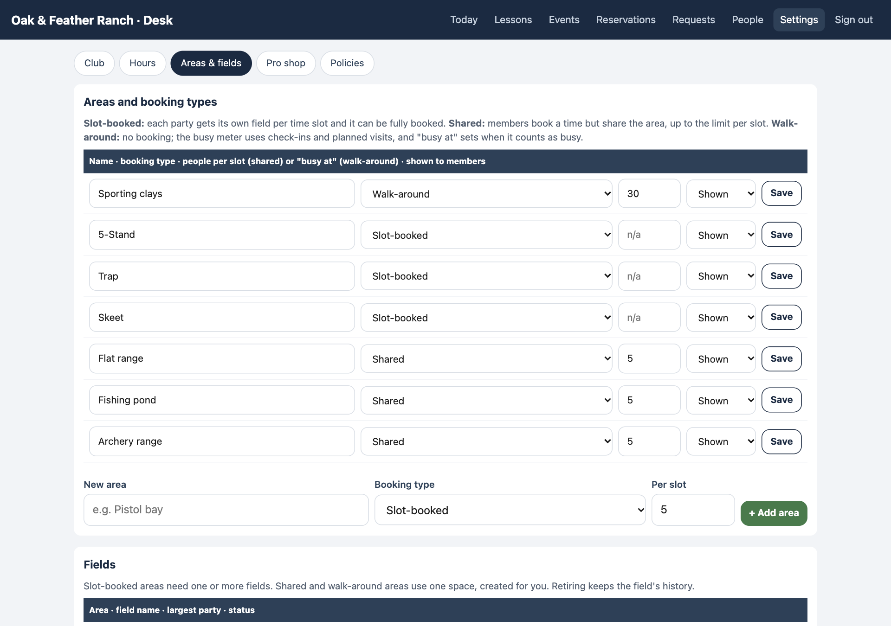
<p>
  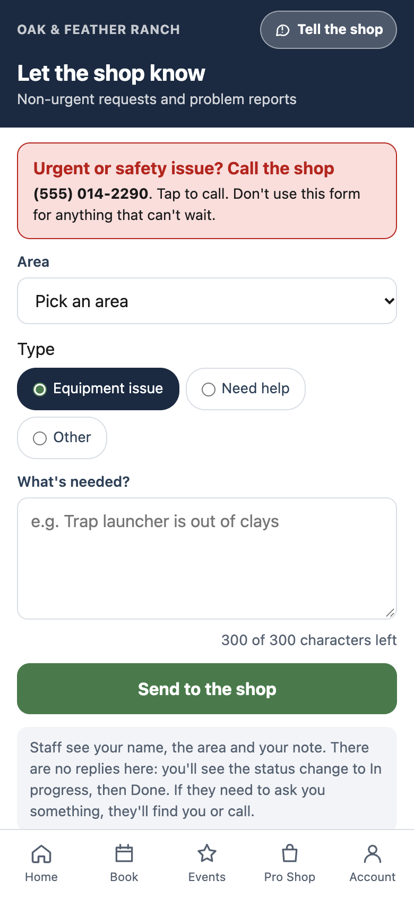
</p>
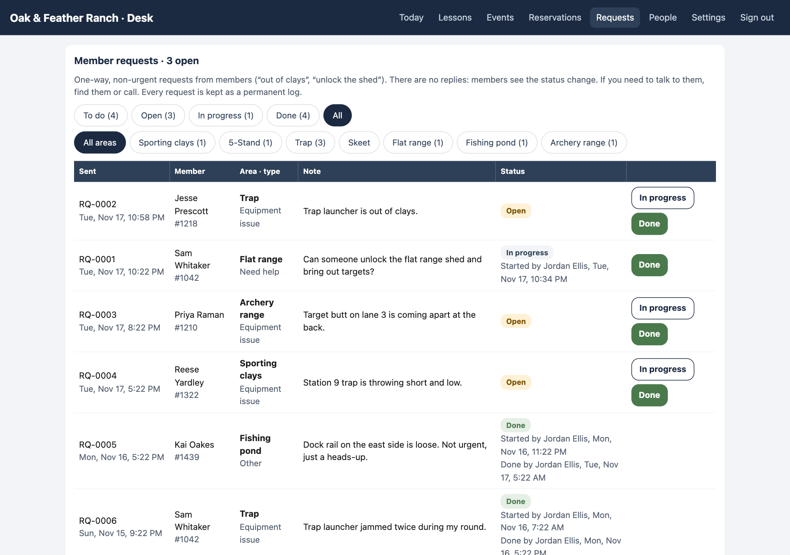

## Later (deliberately out of scope)

| Later | Why not now |
|---|---|
| **Payments** | The billing vendor has no API until late 2027, and members pay at the counter today. |
| **POS / inventory integration** | The highest-value idea in the research, but it depends on the club's system. "Reserve, then staff confirm" gets most of the benefit with zero integration risk. |
| **Push notifications, SMS and emails** | They need outside services. Every status is shown in the app, and `lib/notify.ts` is the single place to add them. |
| **Email verification and self-serve password reset** | They need email. For now, staff can issue a one-time temporary password from the People page. |
| **Lessons and events reserving a field** | A trap lesson doesn't yet block a trap field. Staff can book the field alongside. |
| **Waitlists for fields** | Events have waitlists; fields don't yet. Full times point members to other times and areas. |
| **Replies, photos or notifications on shop requests** | Requests are one-way by design (a status, not a chat). A short closing note from staff is the first thing to add if members want one. |
| Guest e-waivers, QR self check-in, reminders, weather alerts, live desk updates, reporting | Next on the roadmap in the case study. |

## Success metrics

| Metric | Type | Baseline → 6-month target | How the app measures it |
|---|---|---|---|
| **Self-serve booking share** | **North Star** | 0% → 60% | Every booking records its source (`app` or `phone`); shown live as *Booked in app* on the desk |
| Booking calls per week | Input | 164 → 70 | Proxy: bookings with source `phone` |
| No-show rate | Input | 9% → 5% | One-tap check-in and no-show on the desk |
| Peak utilization | Input | 71% → 80% | The busy meter's formula, per area |
| Double-booking incidents | Guardrail | 6/month → 0 | Prevented by database rules for fields, shared areas and instructors; covered by tests |

New in the beta: **waitlist conversion** (promotions ÷ waitlist joins), **pickup decline and expiry rate** (the evidence for POS integration), **lesson utilization** per instructor, and **clays check-ins per hour**.

## Try it locally

You need [Node.js](https://nodejs.org) (LTS) and, for screenshots only, Google Chrome.

```bash
npm install
npm run dev          # open http://localhost:3000
```

The first page load creates a local SQLite database (`rangeday.db`). Locally the app runs in demo mode (see `.env.development`), so it fills itself with synthetic members, bookings and lessons.

| Command | What it does |
|---|---|
| `npm run dev` | Run the app locally |
| `npm test` | Run the 92 rule tests |
| `npm run reset-db` | Delete the local database; it's rebuilt on the next page load |
| `npm run screenshots` | Retake the README screenshots (app must be running) |

## Settings (environment variables)

| Variable | What it's for | Example |
|---|---|---|
| `TURSO_DATABASE_URL` | Where the hosted database lives. Leave unset locally to use a file. | `libsql://your-db.turso.io` |
| `TURSO_AUTH_TOKEN` | The password for that database. Keep it secret: only in Vercel, never in code. | *(from Turso)* |
| `DEMO_MODE` | `true` for a public demo: demo logins, synthetic data, weekly reset and locked branding. **Leave it unset for a real club**: nothing is ever wiped. | `true` |
| `STAFF_EMAILS` | Emails that become staff when they sign up or log in. That's how the first staff account is made; after that, use the People page. | `owner@club.com,desk@club.com` |

## How it's built

| Choice | Why |
|---|---|
| **Next.js 16 (React)** | Pages and server logic in one project, with server actions for forms. Vercel hosts it free. |
| **SQLite via libSQL / Turso** | Zero setup locally (a single file). In production, Turso's free hosted SQLite runs the same code. |
| **Numbered migrations** | The database records its version and upgrades itself, so changes never need a wipe. |
| **Plain SQL, no ORM; Node's built-in crypto** | Fewer tools: no auth or ORM library. Passwords use scrypt, and sessions are random tokens stored only as hashes. |
| **Vitest + Playwright** | Rule tests against a real temporary database, plus browser checks of every flow at 360 px, at 390 px and with 200% text size. |

**Where the rules live.** Every rule is in `lib/`, separate from the screens:
- `booking.ts` (fields and shared areas)
- `visits.ts` (walk-around course)
- `lessons.ts`
- `busy.ts`
- `events.ts`
- `shop.ts`
- `requests.ts` (Let the shop know)
- `accounts.ts`
- `staff.ts`
- `admin.ts` (settings)

Screens ask "can this happen?" and show the answer in plain English.

**Nothing can be overbooked, even with simultaneous taps:**
- **Fields:** a unique database index.
- **Shared areas, lessons, event places and waitlist promotions:** a single SQL statement that checks and saves together.

Tests fire simultaneous requests at each one and check that the limit holds.

```
app/(member)/   member screens: home, book (fields, shared, walk-around, lessons), events, shop (+ Let the shop know), account
app/staff/      staff desk: today, lessons and instructors, events, reservations, requests, people, settings
app/login, app/signup
lib/            business rules, data model, migrations, starting data
tests/          rule tests
scripts/        reset and screenshot helpers
```

## Deploying

The live demo runs on **Vercel** (hosting) and **Turso** (database), both on free plans. Set the environment variables above in Vercel → Settings → Environment Variables, then redeploy. On the first visit the database upgrades itself to the latest structure and creates the club's starting setup.

---

**Built with AI assistance (Claude Code).** I set the scope, priorities and product decisions, and reviewed and tested the result. Claude Code wrote most of the code under my direction. The product thinking is in the [case study](RangeDay_Product_Case_Study.pdf) and [PRODUCT_NOTES.md](PRODUCT_NOTES.md).

Nicholas Brand · Portfolio project · 2026
