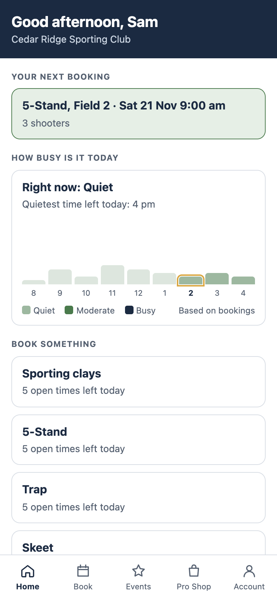
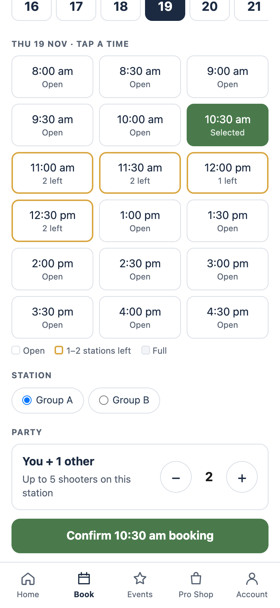
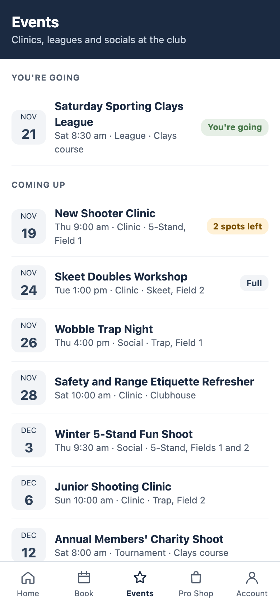
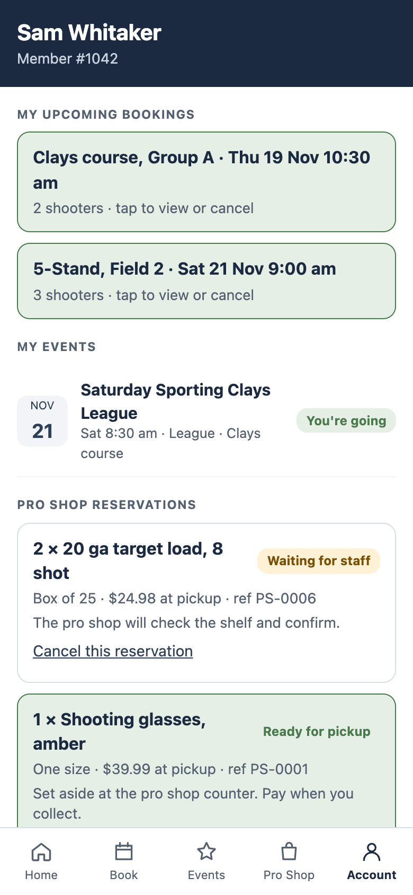
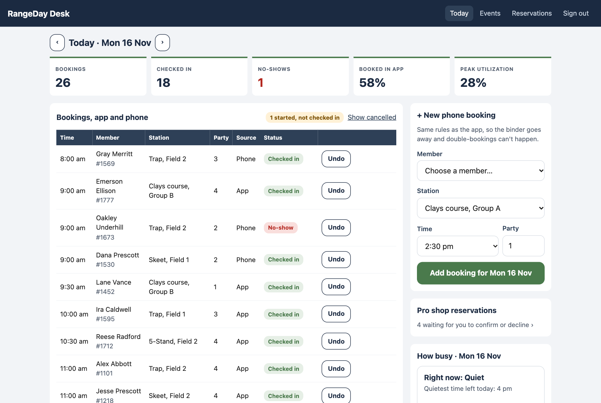
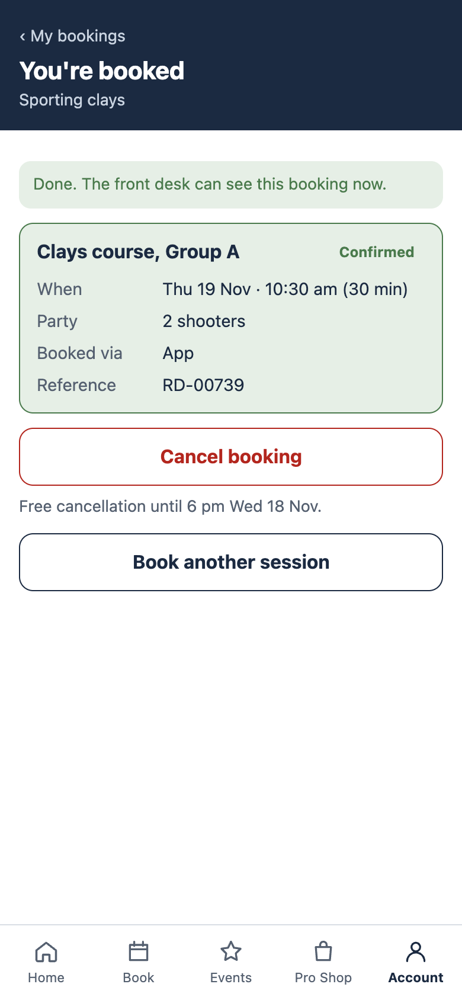
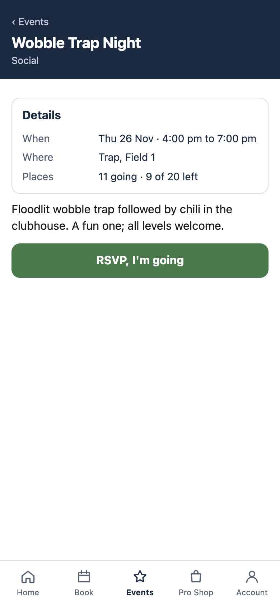
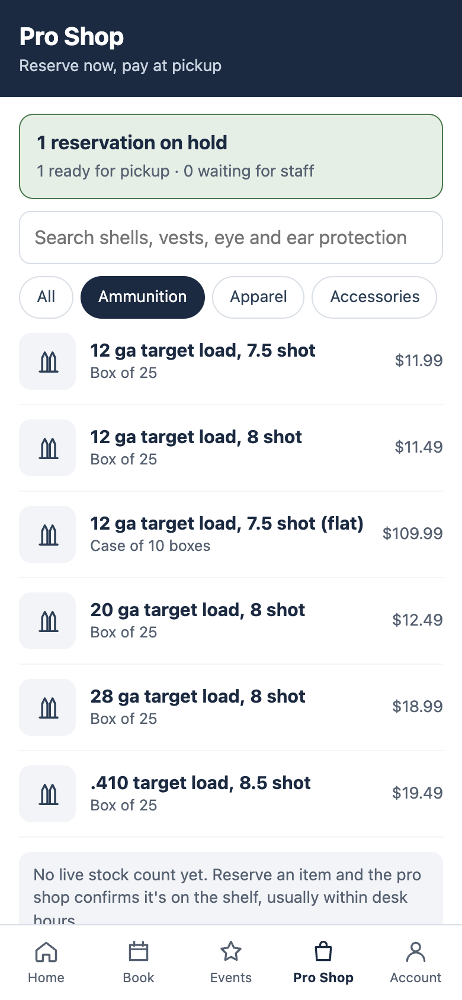
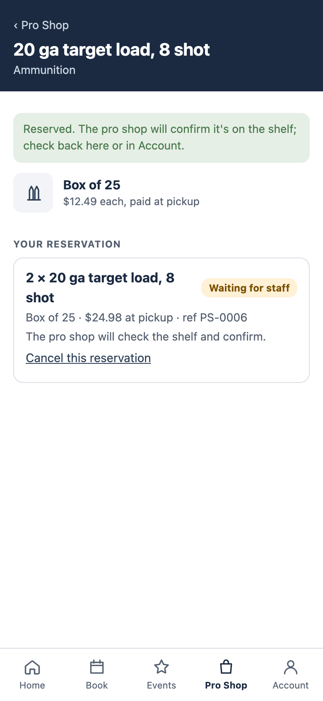
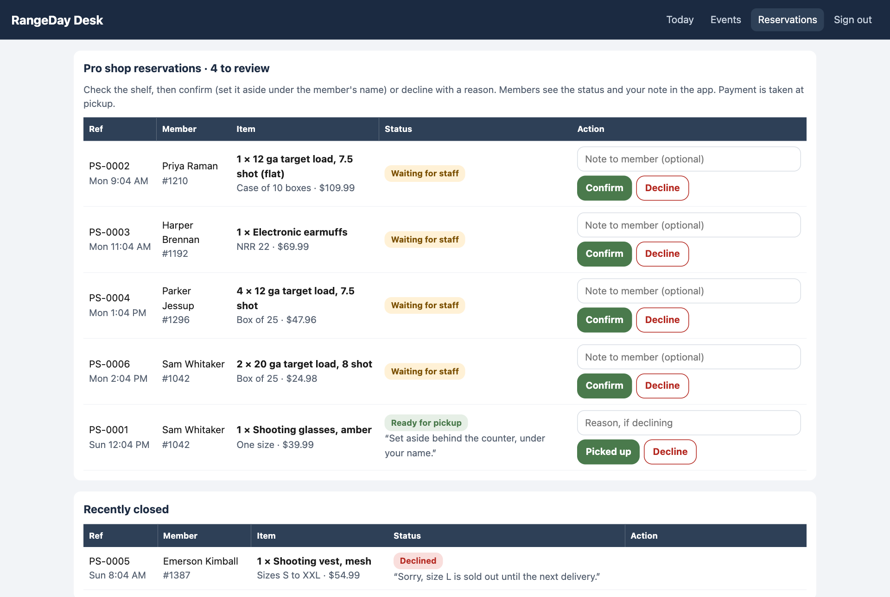

# RangeDay

**A member app for a private sporting club: book a station, RSVP to events, reserve pro shop gear, and give the front desk one screen for the whole day.**

A working MVP built from my product case study ([RangeDay_Product_Case_Study.pdf](RangeDay_Product_Case_Study.pdf)) and its [wireframes](wireframes.html). Mobile-first, with a separate staff console for tablet or desktop.

**Live demo:** _add your Vercel link here_ · Sign in as **Sam (member)** or **Jordan (staff)**, no password needed.

> **Data notice.** Cedar Ridge Sporting Club is fictional. Every member, booking, event, item and number in this app is synthetic.

<p>
  
  
  
  
</p>


---

## The problem

At Cedar Ridge (850 members, about 600 active), **everything runs through the front desk phone and a paper binder.**

- Members can only book during desk hours, and can't see what's open. *"I plan my weekend at 11 pm. Calling isn't an option then."*
- **51% of 640 desk calls** in two weeks were about bookings, and another **18% were "do you have X in stock?"**
- The binder causes **double-bookings (about 6 a month)** and nobody can measure **no-shows (about 9%)**.
- Staff spend roughly **20 hours a week** on routine calls, while members standing at the desk wait.

*(All figures are synthetic, from the case study's discovery work: 14 member interviews, 6 staff interviews, a 212-person survey and a call log.)*

## Who it's for

| Persona | Job to be done | What they get in this MVP |
|---|---|---|
| **Sam, weekend member** | Lock in a Saturday slot without calling | Book in a few taps, any time; see how busy it is; reserve shells before driving out |
| **Jordan, front desk lead** | Keep the day running; serve members on site | One list of app and phone bookings, one-tap check-in, a queue of pro shop requests |
| **Operations manager** (secondary) | Measure utilization and no-shows | Check-in and no-show tracking, utilization and self-serve share on the desk screen |

## What's in the MVP

| # | Feature | What it does |
|---|---|---|
| 1 | **Book range sessions** | Pick an activity (clays, 5-Stand, trap, skeet), a day, a half-hour slot and a station. Slots show *Open*, *1–2 left* or *Full* before you commit. Double-booking is impossible, enforced by the database. Members cancel until 6 pm the day before. |
| 2 | **Events with RSVP** | Clinics, leagues and socials, with places left. RSVP or cancel. Events can't be overfilled. |
| 3 | **"How busy is it today"** | An hour-by-hour meter based on bookings, with the quietest time left today. |
| 4 | **Reserve for pickup** | Browse the pro shop and reserve an item. No stock count, no payment. Staff confirm or decline, and the member sees the status and any note. |
| 5 | **Staff desk** | Today's bookings from app *and* phone in one list, check-in and no-show, phone bookings under the same rules, event management, and the reservation queue. |

<p>
  
  
  
  
</p>


## What I cut, and why

| Cut | Why |
|---|---|
| **Live stock levels / POS integration** | The highest-value idea in the case study, but it depends on the club's inventory system. "Reserve, then staff confirm" gets most of the benefit (fewer stock calls, no wasted trips) with zero integration risk. It's first on the roadmap. |
| **Payments** | The billing vendor has no API until late 2027, and members pay at the counter today. Adding payments would add risk without changing whether members adopt the app. |
| **Reminders and notifications (push/SMS)** | They need outside messaging services and real contact details. Members see every status in the app instead. |
| **Waitlists** | Useful only once slots fill up regularly. Full slots now point members to other times and stations instead. |
| **Real sign-in** | A portfolio demo shouldn't hold real credentials. The demo login is one tap, and real auth is a known, solved problem for later. |
| **Guest e-waivers, lessons, QR check-in** | Q2 work in the case study roadmap. Not needed to prove the core loop. |

**How this differs from the case study's MVP.** The case study's Q1 MVP leads with reminders, the stock check and weather alerts. All three need outside systems a prototype can't fake honestly. So this build covers the slice that *can* be demonstrated end to end. It pulls events (Q2) and reserve-for-pickup (Q3) forward, because they show the full member-to-staff loop. The reasoning is in [PRODUCT_NOTES.md](PRODUCT_NOTES.md).

## Success metrics

| Metric | Type | Baseline → 6-month target | How this MVP measures it |
|---|---|---|---|
| **Self-serve booking share** | **North Star** | 0% → 60% | Every booking records its source (`app` or `phone`); shown live as *Booked in app* on the desk |
| Booking calls per week | Input | 164 → 70 | Proxy: bookings with source `phone` |
| Stock-question calls per week | Input | 58 → 25 | Proxy: reservations made in the app |
| No-show rate | Input | 9% → 5% | One-tap check-in and no-show on the desk |
| Peak Saturday utilization | Input | 71% → 80% | Same formula as the busy meter: booked station-time ÷ available |
| Double-booking incidents | Guardrail | 6/month → 0 | Prevented by a database rule, not just the UI; covered by tests |
| Desk phone answer rate, member satisfaction | Guardrail | 88% → 95%, 4.3 → 4.3 | Outside the app (phone system, quarterly survey) |

New for the pickup feature: **time from reservation to staff decision** and **decline rate**. A high decline rate is the evidence that would justify the POS integration.

## Roadmap

**Next: make it pilot-ready**
- **POS / inventory integration.** A read-only feed from the club's inventory system, refreshed at least every 15 minutes, shows *In stock / Low / Out (next delivery date)* on each item. Reservations for in-stock items can then be pre-checked automatically, and staff only handle exceptions. Phase 2 writes back: reserved units are held in the POS, and pickup completes the sale at the till.
- **Booking reminders** (push and SMS, 24 h and 2 h before) with one-tap cancel, to cut no-shows.
- **Weather and closure alerts:** staff close a field once, and every booked member is told.
- **Real sign-in** (email magic link) and a large-text / high-contrast mode for older members.
- Events reserve their stations automatically, so a clinic on Skeet Field 2 blocks member bookings there.
- Live updates on the desk screen, with no refresh needed.

**Then**
- Waitlist with auto-fill when a slot is released.
- Guest pre-registration and e-waivers.
- No-show and utilization reporting for the operations manager.
- Lesson and instructor booking; QR check-in.
- Busy meter on the booking screen for any chosen day.

**Later**
- Payments and account charges (when the billing API exists).
- Clays scorecards (waiting on evidence from the post-launch survey).

**Not planned:** dynamic pricing (conflicts with flat-fee membership) and a social feed (moderation cost, no evidence).

## Try it locally

You need [Node.js](https://nodejs.org) (LTS) and, for screenshots only, Google Chrome.

```bash
npm install
npm run dev          # open http://localhost:3000
```

That's it. The first page load creates a local SQLite database (`rangeday.db`) and fills it with demo data.

| Command | What it does |
|---|---|
| `npm run dev` | Run the app locally |
| `npm test` | Run the 30 rule tests (booking, events, busy meter, pickup, staff) |
| `npm run reset-db` | Delete the local database; fresh demo data on the next page load |
| `npm run screenshots` | Retake the README screenshots (app must be running) |

Staff can also press **Reset demo data** on the desk screen. Demo data is generated around *today's* date and refreshes itself once it's more than a week old, so the demo never looks stale.

## How it's built

| Choice | Why |
|---|---|
| **Next.js (React)** | Pages and server logic live in one project. It's the most widely used React framework, and Vercel hosts it free. |
| **SQLite, via libSQL / Turso** | Zero setup locally (a single file). In production, Turso's free hosted SQLite runs the same code; only one setting changes. |
| **Plain SQL, no ORM** | Fewer tools to learn; every query is readable in the file that uses it. |
| **Vitest** | Fast tests for the business rules, run against a real (temporary) database. |

**Where the rules live.** Every rule is in `lib/`, separate from the screens: `booking.ts`, `events.ts`, `busy.ts`, `shop.ts` and `staff.ts`. Screens ask "can this happen?" and show the answer in plain English. That separation is what makes the rules testable.

**No double-booking, twice over.** The app checks before saving, *and* a unique index in the database refuses a second live booking for the same station and slot. Even two members tapping Confirm at the same instant can't both win, and a test checks exactly that.

```
app/(member)/   member screens: home, book, events, shop, account
app/staff/      staff desk: today, events, reservations
lib/            business rules, data model, demo data
tests/          rule tests
scripts/        reset and screenshot helpers
```

## Deploying

The live demo runs on **Vercel** (hosting) and **Turso** (database), both on free plans. Set two environment variables in Vercel, `TURSO_DATABASE_URL` and `TURSO_AUTH_TOKEN`; the database fills itself with demo data on first visit. Without them, the app uses the local SQLite file.

---

**Built with AI assistance (Claude Code).** I set the scope, priorities and product decisions, and reviewed and tested the result. Claude Code wrote most of the code under my direction. The product thinking is in the [case study](RangeDay_Product_Case_Study.pdf) and [PRODUCT_NOTES.md](PRODUCT_NOTES.md).

Nicholas Brand · Portfolio project · 2026
